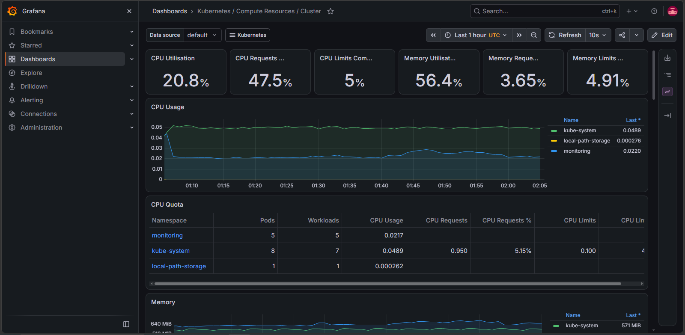

# Monitoring avec Prometheus et Grafana

Installation sur un cluster kind avec le chart kube-prometheus-stack.

    helm repo add prometheus-community https://prometheus-community.github.io/helm-charts
    helm repo update
    helm install monitoring prometheus-community/kube-prometheus-stack -n monitoring --create-namespace --set alertmanager.enabled=false
    kubectl port-forward svc/monitoring-grafana 3000:80 -n monitoring

Accès : http://localhost:3000, utilisateur `admin`. Le mot de passe se lit dans le secret `monitoring-grafana`.

